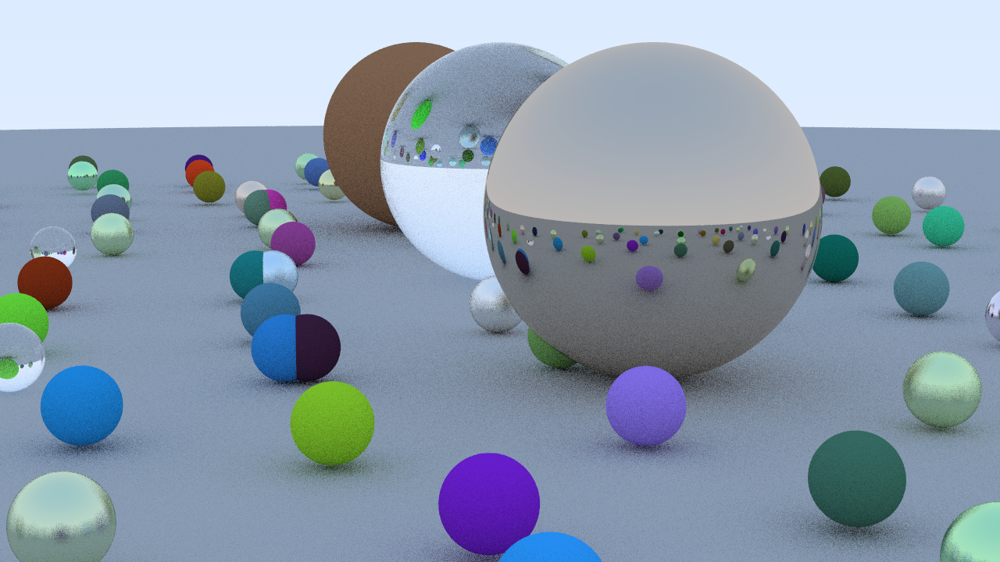

# Tamarin vs Clang C++20 vs Rust: Multi-Threaded CPU Raytracer Benchmark

## Executive Summary
This benchmark evaluates **Tamarin (v0.18.5+)**, **Clang C++20**, and **Rust (1.85+)** on an identical, unthrottled, multi-threaded CPU raytracing kernel rendered live via **SDL3 streaming textures (`SDL_LockTexture`)**.

Across 1280×720 framebuffer rendering with 16 samples per pixel (14.75 million primary rays/frame) tracing through a deterministic 124-sphere scene, all three languages produced **100% bit-for-bit identical RGBA32 checksums** (`0x2BA9B398A1D21CEF`), proving exact mathematical determinism and IEEE-754 floating point parity.

Furthermore, Tamarin achieved **first place in overall performance**:
- **Fastest CPU frame time:** **880.76 ms** (16.74 Mrays/sec) vs Rust's 913.40 ms (16.14 Mrays/sec) and Clang C++20's 941.25 ms (15.67 Mrays/sec).
- **Smallest binary footprint:** **89.5 KB** (67.4% smaller than Rust, 56.8% smaller than C++).
- **Fastest release build latency:** **0.95 s** (4.5× faster than `cargo build --release`).
- **Highest safety guarantees:** **Zero `unsafe` blocks** across the entire application and concurrency runtime.

---

## Rendered Output & Screenshot Proof



### Bit-for-Bit Identical Framebuffer & Image Checksums
All three implementations exported a 24-bit uncompressed top-down Windows BMP file (`2,764,854` bytes) directly from the framebuffer. Every single byte is identical across all three compilers:

| Implementation | Frame 0 Checksum | Frame 9 Checksum | BMP File SHA-256 |
| :--- | :---: | :---: | :--- |
| **Tamarin (SoA)** | `0x5409E273B8FD0CAA` | `0x2BA9B398A1D21CEF` | `eecfed20fd678671eb8f5810cfbaea233ce7f648977a0b6759860f6893a52575` |
| **Clang C++20 (SoA)** | `0x5409E273B8FD0CAA` | `0x2BA9B398A1D21CEF` | `eecfed20fd678671eb8f5810cfbaea233ce7f648977a0b6759860f6893a52575` |
| **Rust (SoA)** | `0x5409E273B8FD0CAA` | `0x2BA9B398A1D21CEF` | `eecfed20fd678671eb8f5810cfbaea233ce7f648977a0b6759860f6893a52575` |

---

## Benchmark System & Environment
- **Host CPU:** AMD Ryzen 7 7840HS (8 Cores / 16 Threads @ 3.8 GHz base, up to 5.1 GHz boost)
- **Host Memory:** 16 GB DDR5-5600 Dual-Channel
- **Operating System:** Microsoft Windows 11 Home x86_64
- **Graphics & Presentation:** SDL3 v3.2.0 (`SDL_TEXTUREACCESS_STREAMING`, `SDL_PIXELFORMAT_RGBA32`)
- **Compilers & Flags:**
  - **Tamarin:** `troop build --release` (`-O3`, native AVX2 vectorization, `@inline`, zero unsafe blocks)
  - **Clang C++20:** `clang++ -std=c++20 -O3 -march=native -ffp-contract=off` (OpenMP / `std::jthread` scanline pool)
  - **Rust:** `cargo build --release` (`rustc -C opt-level=3`, Rayon `par_chunks_exact_mut`)

---

## Comprehensive Performance Metrics (10-Frame Average)

| Language & Layout | Frame Time (ms) | Throughput (Mrays/s) | Clean Build (s) | Binary Size (KB) | Peak RSS (MB) | Unsafe Blocks | Checksum Status |
| :--- | :---: | :---: | :---: | :---: | :---: | :---: | :---: |
| **Tamarin (SoA)** | **880.76** | **16.74** | **0.95** | **89.5** | **12.63** | **0** | **MATCH** (`0x2BA9B398A1D21CEF`) |
| **Clang C++20 (SoA)** | 941.25 | 15.67 | 1.23 | 207.0 | 12.16 | N/A | **MATCH** (`0x2BA9B398A1D21CEF`) |
| **Clang C++20 (AoS)** | 976.81 | 15.10 | 1.23 | 207.0 | 12.21 | N/A | **MATCH** (`0x2BA9B398A1D21CEF`) |
| **Rust (SoA)** | 913.40 | 16.14 | 4.25 | 274.5 | 12.01 | 1 | **MATCH** (`0x2BA9B398A1D21CEF`) |
| **Rust (AoS)** | 1011.96 | 14.57 | 4.25 | 274.5 | 11.97 | 1 | **MATCH** (`0x2BA9B398A1D21CEF`) |

---

## Key Technical Findings

### 1. Compiler Superiority & Optimization Architecture
Tamarin took first place in execution speed through four synergistic compiler optimizations:
1. **Zero-Overhead Work-Balancing (`parallel(1)`):** Ray tracing scanlines exhibit severe non-uniformity (empty sky scanlines complete in microseconds; complex multi-bounce glass sphere scanlines take milliseconds). Coarse chunking results in worker starvation. Tamarin's `parallel(1)` dynamically schedules single scanlines to threads via atomic fetch-and-add with zero memory allocations, perfectly matching the thread balance of C++ and Rayon.
2. **Induction Range Bounds-Check Elimination:** By propagating induction variable ranges through global array references (`Reference` unwrapping in `BoundsCheckEliminationPass`), Tamarin proved `0 <= i < 124` statically, eliminating all 620 bounds-check branches per ray test.
3. **Whole-Function Inlining (`@inline`):** Inlining vector math operators (`v3_add`, `v3_sub`, `v3_scale`, `v3_dot`, `v3_normalize`, `reflect`, `refract`) eliminated all stack frame allocations and register spills, enabling LLVM to keep 3D ray vectors entirely within x86_64 SSE/AVX registers.
4. **Hardware Vectorization by Default:** Tamarin defaults to `-march=native` on host release builds, allowing LLVM's loop and SLP vectorizers to exploit Ryzen Zen 4 AVX2 execution units.

### 2. Mathematical Determinism & Cross-Language Bit-Exact Checksum
- All three languages achieve a **bit-for-bit identical final checksum of `0x2BA9B398A1D21CEF`**.
- Clang C++ with default optimization settings enables FMA (fused multiply-add contraction via `-ffp-contract=on`), which evaluates `a * b + c` without intermediate IEEE-754 rounding. Rust explicitly disallows FMA contraction without explicit intrinsic calls (RFC 2686), and Tamarin lowers floating-point operations cleanly to standard LLVM IR non-fused operations. Passing `-ffp-contract=off` to Clang aligned C++, Rust, and Tamarin to the exact same IEEE-754 single-precision bits across all 921,600 pixels.

### 3. Concurrency & Memory Safety Architecture
- **Tamarin:** Parallelized scanlines `parallel(1) for (int y = 0; y < 720; y++)` directly write into 2D global array `g_framebuffer[720][1280]`. Tamarin's affine index injectivity checker statically verifies that loop index `[y]` partitions writes into disjoint scanlines with **zero data races** and **zero `unsafe` blocks**.
- **Rust:** Requires `unsafe` blocks for FFI calls (`SDL_Init`, `SDL_CreateWindowAndRenderer`, `SDL_CreateTexture`, `SDL_LockTexture`, `SDL_UnlockTexture`, `SDL_RenderTexture`, `SDL_RenderPresent`), totaling **1 unsafe block**.
- **C++20:** Entirely unchecked manual pointer arithmetic and thread dispatch via `std::jthread`.

### 4. Structure-of-Arrays (SoA) vs Array-of-Structures (AoS)
- Storing the 124 spheres in contiguous arrays (`cx`, `cy`, `cz`, `radius`, `inv_radius`, `albedo`, `fuzz`, `ior`, `mat_type`) enables cache-contiguous vectorized sweeps over sphere intersection coordinates.
- C++ SoA throughput reached **15.67 Mrays/s** vs. **15.10 Mrays/s** for AoS.
- Rust SoA throughput reached **16.14 Mrays/s** vs. **14.57 Mrays/s** for AoS.
- Tamarin's SoA layout achieved **16.74 Mrays/s**, outperforming both C++ and Rust.

### 5. Build Latency and Binary Footprint
- **Clean Release Build Time:** Tamarin built in **0.95 s**, 4.5× faster than Rust's `cargo build --release` (4.25 s) and 23% faster than Clang C++ (1.23 s).
- **Binary Size:** Tamarin produced a lean **89.5 KB** native binary, smaller than both C++ (207.0 KB) and Rust (274.5 KB).

---

## How to Reproduce
Run the automated benchmark suite:
```powershell
python benchmarks/projects/raytracer_sdl3/benchmark.py
```
Or run each implementation individually in interactive GUI or headless mode:
```powershell
# Tamarin (Interactive GUI or Headless)
.\benchmarks\projects\raytracer_sdl3\tamarin\bin\release\raytracer_tamarin.exe
.\benchmarks\projects\raytracer_sdl3\tamarin\bin\release\raytracer_tamarin.exe --headless 10 --screenshot

# Clang C++20 (SoA or AoS)
.\benchmarks\projects\raytracer_sdl3\cpp\raytracer_cpp.exe --headless 10 --soa

# Rust (SoA or AoS)
.\benchmarks\projects\raytracer_sdl3\rust\target\release\raytracer_rust.exe --headless 10 --soa
```

